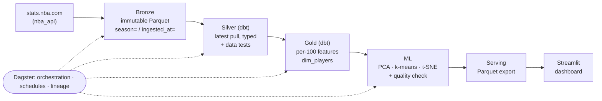

# CourtPrint

**An NBA data platform that turns player-tracking stats into statistical fingerprints, revealing each player’s archetype, closest comps, and how their role changes over time.**

CourtPrint is built pipeline-first. NBA stats are ingested into an immutable bronze layer, then modeled with dbt into tested silver and gold tables. A machine-learning step clusters players into archetypes, and the results are served through a Streamlit dashboard (check link). Dagster orchestrates every stage as a single asset graph, with scheduling, lineage, and automated quality checks.


## Architecture



| Layer | Tech | What it does |
|---|---|---|
| Ingestion | Python, `nba_api` | Pulls 9 season-total tables (box score, advanced, hustle, 6 tracking tables) |
| Bronze | Parquet, Hive partitions | Append-only. Every pull is a new file, so re-runs are safe and history is kept |
| Silver | dbt + DuckDB | Keeps the latest pull per player-season, casts types, runs data tests |
| Gold | dbt + DuckDB | Per-100-possession features for qualified players; player dimension |
| ML | scikit-learn | StandardScaler → PCA (10 comps) → k-means archetypes → t-SNE map; writes results back to the warehouse |
| Serving | Parquet | Small export the dashboard reads, so it deploys anywhere with no database |
| Orchestration | Dagster | Asset graph, nightly in-season schedule, dbt tests as asset checks, embedding-quality check |
| CI | GitHub Actions | Unit tests, full pipeline on synthetic data, dashboard smoke test |

### Design decisions worth knowing

- **Append-only bronze + dedupe in silver.** Ingestion never overwrites anything. The `latest_pull` dbt macro keeps the newest pull per player-season, so you can re-run ingestion any number of times without creating duplicates, and you keep a full audit trail. There's a test for exactly this.
- **Incremental nightly loads.** During the season, the schedule re-pulls only the current season. Older seasons are frozen in bronze.
- **One embedding space across seasons.** The model is fit on all player-seasons pooled, so a player's 2023-24 and 2025-26 profiles are directly comparable. That's what powers the career-path view.
- **Hybrid ingestion.** stats.nba.com blocks most cloud and datacenter IPs. So the extractor runs on a local machine (or a self-hosted runner) and writes to `LAKE_ROOT`, which can be local disk *or* a cloud bucket. Everything downstream runs anywhere.
- **Storage is configuration.** `LAKE_ROOT` and `WAREHOUSE_PATH` are environment variables. Swapping local disk for GCS/S3 and DuckDB for MotherDuck needs no code changes (see *Moving to the cloud*).
- **Synthetic demo source.** A generator produces fake players with the exact nba_api schemas, so the whole pipeline runs offline and in CI.

## Dashboard

| Tab | What it shows |
|---|---|
| Scouting report | Player card, radar of six skill categories vs. archetype average, 10 nearest statistical comps (this season or all seasons), within-season percentiles |
| Archetype map | Every player in 2D, colored by archetype, with a card describing each archetype |
| Team builds | Each roster's minutes split by archetype, plus roster detail |
| Player evolution | A player's path across seasons through the embedding space, with season-over-season radar |
| Pipeline & model | Lineage, lake freshness, model diagnostics, PCA loadings, run history |

## Quick start

```bash
pip install -r requirements.txt

make demo        # full pipeline on synthetic data, no network needed
make dashboard   # http://localhost:8501
make ui          # Dagster UI: lineage graph, runs, schedules (http://localhost:3000)
```

### With real NBA data

Run this on your own machine (stats.nba.com will likely block cloud servers):

```bash
make clean       # remove the demo data
make pipeline    # pulls 3 seasons (~30 API calls, a few minutes), then dbt + ML
make dashboard
```

Seasons, minutes threshold, number of archetypes and features are all in `config.py`. Archetype names are assigned automatically by matching each cluster to templates in `config.py`. Look at the archetype cards after a real run, and rename via `ARCHETYPE_OVERRIDES` if a name doesn't fit.

### Other commands

```bash
make extract     # just land real data in bronze
make dbt         # just rebuild silver + gold and run the data tests
make ml          # just refit the model and refresh the serving layer
make test        # unit + end-to-end tests
```

## Project layout

```
courtprint/
├── config.py                 # seasons, thresholds, features, storage locations
├── ingestion/
│   ├── lake.py               # bronze writer (local or gs:// / s3://)
│   ├── extract_nba.py        # real data via nba_api
│   └── extract_demo.py       # synthetic data, identical schemas
├── warehouse/                # dbt project (DuckDB)
│   ├── models/staging/       # silver: one model per bronze table
│   ├── models/intermediate/  # silver: joined player-season totals
│   ├── models/marts/         # gold: fct_player_season_features, dim_players
│   ├── macros/               # latest_pull dedupe, schema naming
│   └── tests/                # custom generic + singular data tests
├── ml/archetypes.py          # PCA, clustering, t-SNE, percentiles, evaluation
├── orchestration/definitions.py  # Dagster assets, checks, schedule
├── dashboard/app.py          # Streamlit app (reads data/serving/ only)
├── data/serving/             # committed: what the deployed dashboard reads
├── tests/                    # pytest: unit + end-to-end
└── .github/workflows/ci.yml
```

## Model

1. Pull season totals and convert volume stats to **per 100 possessions** (pace-adjusted).
2. Keep player-seasons with **500+ minutes**.
3. Standardize 22 features covering scoring, shooting, creation, playmaking, paint work, and defense.
4. **PCA** to 10 components for similarity search.
5. **k-means** (8 clusters) on the components for archetypes, named by matching cluster profiles to templates (Hungarian assignment, so names are unique).
6. **t-SNE** to 2D, only for the map. Distances on the map are approximate; comps always use the full 10-D space.

Diagnostics logged on every run (in `ml.model_runs` and the dashboard): variance explained, trustworthiness, top-10 neighbour preservation, cluster silhouette. A Dagster asset check fails the run if trustworthiness drops below 0.95 or variance explained below 80%.

**Interpretation:** "similar" simply means a similar statistical profile under these features. It says nothing about quality, fit, or defensive impact that the box score and tracking data miss. On real data, archetypes overlap far more than in the synthetic demo; a silhouette around 0.2–0.4 is normal for basketball roles.

## Moving to the cloud

The code is currently already parameterized for it:

| Piece | Local (now) | Cloud |
|---|---|---|
| Lake | `LAKE_ROOT=./data/lake` | `LAKE_ROOT=gs://your-bucket/lake` (+ `pip install gcsfs`) or `s3://…` (+ `s3fs`) |
| Warehouse | DuckDB file | MotherDuck: `dbt build --target prod` with `MOTHERDUCK_TOKEN` set. Or port the models to BigQuery (`dbt-bigquery`) |
| Orchestration | `dagster dev` | Dagster+ Serverless, or a small VM running the Dagster daemon |
| Dashboard | `make dashboard` | Streamlit Community Cloud, pointed at this repo (reads `data/serving/`) |
| Ingestion | local machine | still local or a self-hosted runner (see *Hybrid ingestion* above) |

Planned next steps: Terraform for the bucket and warehouse, a GitHub Actions job running `dbt build` against the cloud warehouse on every PR, and game-level ingestion (box scores per game) for true daily incremental loads.

## Roadmap

- Game-log ingestion with date partitions and incremental dbt models
- Shot-location features (shot zones) and on-demand shot charts
- Salary data join for a "budget comp" finder
- Source freshness checks and failure alerts (Slack/email)
- Terraform + cloud deployment

## Data attribution

Data comes from the NBA's stats site via the community [`nba_api`](https://github.com/swar/nba_api) package, and this data is unofficial. The synthetic demo data is fictional.
